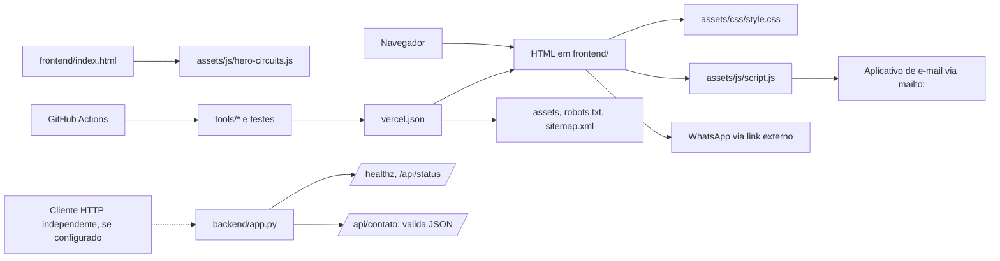

# 02 — Relações internas e externas

## Fluxos confirmados

A aresta pontilhada indica somente que a API Flask é um componente independente no repositório. Ela não comprova cliente ou implantação ativos. O formulário em `frontend/pages/contato.html` usa controles de preparação de mensagem; `script.js` constrói a mensagem e muda para `mailto:` ou copia o texto. A página também oferece links diretos de e-mail, telefone e WhatsApp.

## Relações internas

- As páginas HTML compartilham CSS e `script.js`; a home acrescenta `hero-circuits.js`.
- `vercel.json` mapeia rotas limpas para arquivos HTML, assets, `robots.txt`, `sitemap.xml` e 404. `tools/site_tools.py` interpreta regras estáticas para validar destinos, links e servir localmente.
- `browser_check.py` usa `site_tools.Site` e Chromium/Playwright; `lighthouse_check.py` também utiliza o servidor/regras locais e executa Lighthouse.
- `generate-sitemap.js` deriva URLs de rotas; `sitemap-dates.json` fornece datas editoriais. `version-assets.js` calcula versões dos assets e sincroniza referências nos HTML.
- `backend/test_app.py` cobre rotas, configuração, cabeçalhos, CORS, rate limit e validação da mensagem no Flask.

## Relações externas

- Navegador → aplicativo de e-mail local via protocolo `mailto:`.
- Navegador → WhatsApp via URL `wa.me`.
- Cliente HTTP independente → Flask somente se a aplicação for executada e exposta separadamente; essa implantação não foi verificada.
- CI → GitHub Actions, instalação Node/Python e browser de teste conforme workflow.
- Pipeline/usuário → Vercel como alvo de publicação estática. Nenhuma chamada browser→API Flask foi encontrada nos arquivos examinados.

## Dependências dinâmicas / limites de extração

Os vínculos HTML→script/CSS, atributos `href`, rewrites, criação dinâmica de elementos SVG e links externos são resolvidos por markup/configuração/runtime do browser; não são todos equivalentes a imports estáticos. `hero-circuits.js` cria elementos via `document.createElementNS`, registra listeners e inicia `requestAnimationFrame`; Graphify reconhece funções desse arquivo, mas a semântica visual e o fluxo acionado por eventos precisam de inspeção no código.

**Evidência principal:** `frontend/index.html:212-214`; `frontend/pages/contato.html:36-50`; `frontend/assets/js/script.js:1, 181-238, 267-309`; `frontend/assets/js/hero-circuits.js:35-...`; `backend/app.py:174-229`; `tools/site_tools.py:48-173`; `tools/browser_check.py:127-206`; `tools/lighthouse_check.py:56-...`; `vercel.json`.
